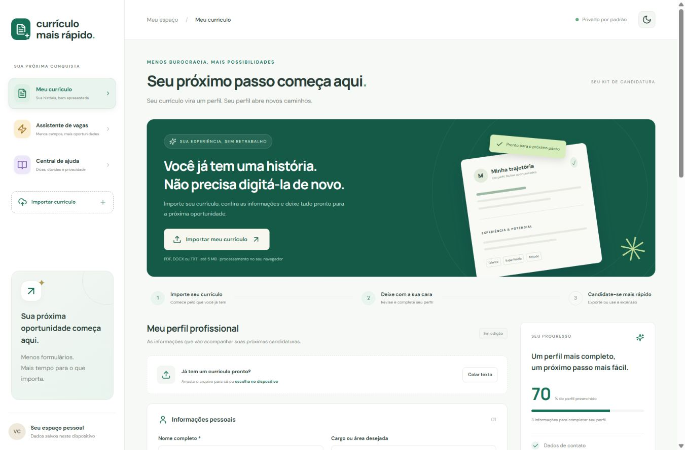

# Currículo Mais Rápido

Um perfil, menos retrabalho nas candidaturas. Aplicação em português que transforma um currículo existente em dados revisáveis e reutilizáveis.

[](https://github.com/Jpgoncalvesz/curriculo-mais-rapido/actions/workflows/ci.yml)
[](LICENSE)



Código aberto sob a [licença MIT](LICENSE). Veja [como contribuir](CONTRIBUTING.md) e a [política de segurança](SECURITY.md).

## Funcionalidades entregues

- Interface responsiva com modo claro e escuro persistente.
- Importação de PDF com texto selecionável, DOCX e TXT (5 MB).
- Reconhecimento por padrões de nome, e-mail, telefone, LinkedIn e seções. Revisão humana obrigatória; não é IA generativa.
- Edição de contato, objetivo, resumo, experiência, formação e habilidades.
- Salvamento local mediante ação do usuário, exportação/restauração JSON e exclusão.
- Currículo imprimível em A4: use “Salvar como PDF” na janela de impressão.
- Extensão Chrome/Edge Manifest V3 para campos comuns, com seleção e revisão antes de preencher.
- API Java/Spring Boot para extração opcional, sem persistência de documentos.

## Estrutura

```text
frontend/    React + TypeScript + Vite
backend/     Java 21 + Spring Boot + Apache Tika + Maven
extension/   Extensão Manifest V3, JavaScript sem dependências
docs/        Arquitetura, API, validação e texto para LinkedIn
.github/     Fluxo de integração contínua
```

## Executar o site

Requisitos: Node.js 22.12 ou superior e npm.

```sh
git clone https://github.com/Jpgoncalvesz/curriculo-mais-rapido.git
cd curriculo-mais-rapido
cd frontend
npm ci
npm run dev
```

Abra http://127.0.0.1:5173. Por padrão, arquivos são processados no navegador e nenhum currículo é enviado à API.

## Executar a API Java

Requisitos: JDK 21 ou superior e Maven 3.9.

```sh
cd backend
mvn test
mvn spring-boot:run
```

API: http://127.0.0.1:8080/api/health.

Para conectar o site à API, copie `frontend/.env.example` para `frontend/.env.local`, configure `VITE_API_URL=/api` e reinicie o Vite. O proxy de desenvolvimento encaminha `/api` para Java. Nesse modo, o arquivo é enviado à API para extração e a interface informa essa mudança. Perfil e revisão permanecem no navegador. Não mantenha essa configuração ao gerar a versão estática sem API.

## Instalar a extensão

1. Abra `chrome://extensions` ou `edge://extensions`.
2. Ative o modo de desenvolvedor e escolha **Carregar sem compactação**.
3. Selecione a pasta `extension`.
4. Exporte o perfil no site e importe o JSON no painel da extensão.
5. Abra a candidatura, clique na extensão e em **Identificar campos**.
6. Revise as sugestões e preencha somente os campos selecionados.

A extensão usa `activeTab`, `scripting` e `storage`. Não acessa sites em segundo plano, não envia dados a servidores e não submete candidaturas. Campos preenchidos ficam desmarcados para evitar sobrescrita involuntária. A versão 1 não processa iframes, shadow DOM, seletores personalizados ou anexos. Alterações dinâmicas exigem nova identificação.

## Verificar e compilar

```sh
cd frontend
npm test
npm run build
npm audit
```

```sh
cd backend
mvn verify
```

O site estático compilado fica em `dist/` na raiz. O pacote Java fica em `backend/target/api-1.0.0.jar`. Há um Dockerfile para a API. Os formatos de importação e limites estão em [docs/API.md](docs/API.md).

## Publicação

### Vercel

O repositório inclui `vercel.json` na raiz e em `frontend`. Importe o projeto com **Root Directory** vazio/`.` (recomendado) ou `frontend`; a configuração correspondente define os comandos e a pasta de saída. Use Node.js 22.x e deixe `VITE_API_URL` sem valor para processar currículos no navegador. Veja o [guia completo de implantação na Vercel](docs/VERCEL.md), incluindo a correção para “No Output Directory named dist found”.

### API e outros ambientes

O site estático pode ser servido por um host HTTPS. A API Java precisa de um ambiente JVM ou de contêiner separado; o host Sites usado neste projeto não executa JVM. Para uma instalação completa, sirva o front-end e encaminhe `/api` para a API Java através de um proxy HTTPS. Configure `SERVER_ADDRESS=0.0.0.0`, `PORT` e `ALLOWED_ORIGIN` no servidor. Configure `VITE_API_URL=/api` **antes** da compilação. Não aponte uma versão pública para `localhost`.

A API entregue é uma extração sem contas nem banco de dados. Antes de disponibilizar um serviço Java público compartilhado, configure autenticação ou cotas, limite de requisições, timeout do processamento, atualizações de dependências e isolamento de arquivos. Não exponha diretamente a porta de desenvolvimento.

O endereço Sites é privado por padrão. Para divulgar uma demonstração ao público, ajuste o acesso explicitamente. O pacote inclui apenas código e exemplos fictícios, nunca currículos reais.

## GitHub

Repositório: [Jpgoncalvesz/curriculo-mais-rapido](https://github.com/Jpgoncalvesz/curriculo-mais-rapido). Não inclua `.env.local`, documentos pessoais, tokens, `node_modules`, `target` ou arquivos de perfil. O fluxo `.github/workflows/ci.yml` executa os testes do site, da API e da extensão a cada push ou pull request.

O código público funciona independentemente do ambiente usado para preparar a demonstração. Identificadores e configurações privadas de hospedagem não fazem parte da distribuição pública.

Consulte [docs/ARQUITETURA.md](docs/ARQUITETURA.md), [docs/VALIDACAO.md](docs/VALIDACAO.md) e [docs/LINKEDIN.md](docs/LINKEDIN.md). A referência visual foi usada apenas para entender o problema; marca, interface e implementação são próprias.
