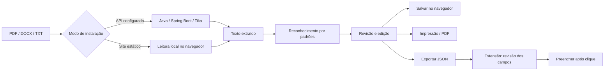

# Arquitetura e decisões

## Fluxo de dados

React e TypeScript centralizam o formato do perfil e a interface. Java fornece uma API real para leitura de documentos quando o operador preferir processamento no servidor. Apache Tika suporta os formatos aceitos e o servidor limita o upload. A API não armazena currículos e não cria perfis remotos.

O primeiro lançamento evita coletar dados de candidatos no servidor da demonstração. O salvamento é explícito em localStorage e fica restrito à origem do site e ao navegador. Não há autenticação, banco de dados ou sincronização nesta entrega. Esses recursos exigem um projeto específico de identidade, armazenamento e retenção.

O JSON tem formato `{ "version": 1, "profile": { ... } }`. Os campos aceitos são name, email, phone, city, linkedin, role, summary, experience, education e skills. Textos são renderizados por React como texto, não como HTML. A restauração verifica tipos e limita o tamanho do arquivo. O usuário deve guardar os backups com cuidado.

Os parsers são carregados sob demanda. O layout de impressão não inclui navegação, botões nem avisos. Não há envio automático de candidaturas, avaliação de candidatos ou promessa de contratação.

## Limites conhecidos

- Extração por heurísticas; PDFs com colunas ou ordem de leitura complexa podem precisar de correção.
- Sem OCR; PDFs escaneados exigem texto manual.
- PDFs são lidos até a página 30 no modo local. Documentos maiores devem ser resumidos ou colados.
- O modo servidor depende da instalação e configuração da API Java.
- A extensão precisa ser instalada manualmente; não está publicada nas lojas.
- Não há garantias de compatibilidade com cada plataforma de vagas. Não foram testados todos os sites externos.
- Fontes do Google são solicitadas na abertura, com fallback do sistema; nenhum dado do currículo é enviado nessa solicitação.

## Próximas evoluções possíveis

Contas e perfis sincronizados, OCR, suporte a formulários específicos, publicação em lojas e testes de compatibilidade por plataforma. Não estão apresentados como funcionalidades já existentes.
